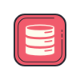
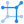
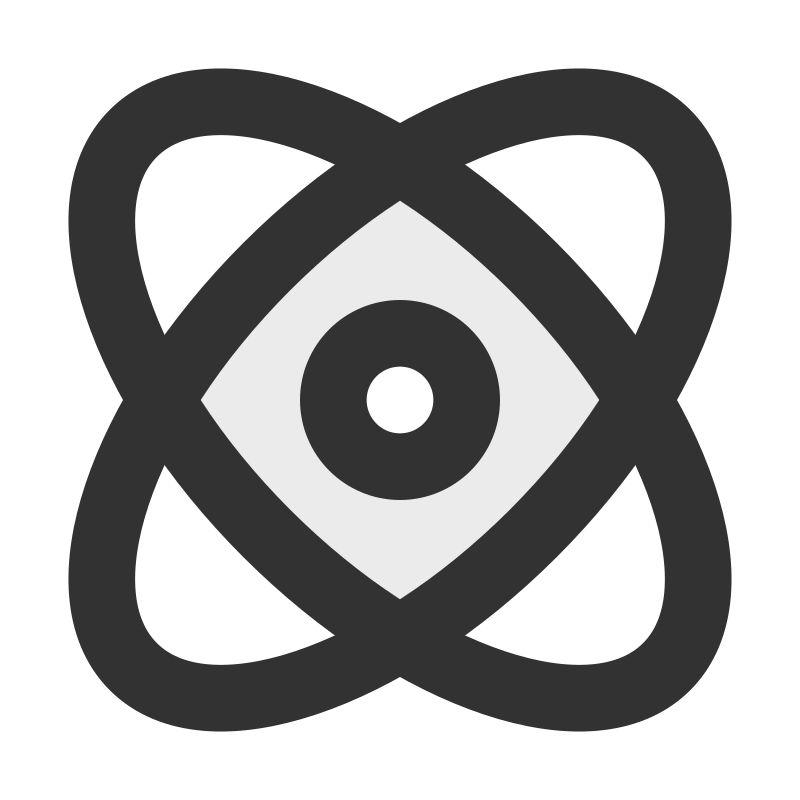

<a href="./README.md" title="Read in english">Inglés</a> · <strong>Español</strong><small> (actual)</small>
<br>
<br>
<details>
  <summary><span style="display:inline-flex;align-items:center;gap:8px;line-height:1;"><picture style="display:inline-block;margin:0">
    <source media="(prefers-color-scheme: dark)" srcset="assets/programming-code-signs-svgrepo-com-white.svg">
    <source media="(prefers-color-scheme: light)" srcset="assets/programming-code-signs-svgrepo-com.svg">
    
  </picture><picture style="display:inline-block;margin:0">
    <source media="(prefers-color-scheme: dark)" srcset="assets/summary-projects-es-white.svg">
    <source media="(prefers-color-scheme: light)" srcset="assets/summary-projects-es.svg">
    
  </picture></span></summary>

  <br>
  <table>
    <tr><th align="left">Proyecto</th><th align="left">Docs</th><th align="left">Descripción</th></tr>
    <tr>
      <td><em><strong>Parallax-Sports</strong></em></td>
      <td><a href="https://tfg-avellaneda-25-26.github.io/parallax-sports-docs/">DOCS</a></td>
      <td>Mi primer proyecto complejo, hecho como proyecto final de mis estudios: mal diseñado, demasiado ambicioso y caótico, pero aprendí mucho con él.</td>
    </tr>
    <tr>
      <td><em><strong><a href="https://github.com/diegokoes/tachy">tachý</a></strong></em></td>
      <td>N/A</td>
      <td>Proyecto personal para ayudarme en mi flujo de trabajo como support engineer. En algunas áreas (sobre todo backend) aprendí mucho; en el frontend usé principalmente IA.</td>
    </tr>
  </table>
</details>

<details>
  <summary><span style="display:inline-flex;align-items:center;gap:8px;line-height:1;"><picture style="display:inline-block;margin:0">
    <source media="(prefers-color-scheme: dark)" srcset="assets/course-svgrepo-com-white.svg">
    <source media="(prefers-color-scheme: light)" srcset="assets/course-svgrepo-com.svg">
    
  </picture><picture style="display:inline-block;margin:0">
    <source media="(prefers-color-scheme: dark)" srcset="assets/summary-courses-es-white.svg">
    <source media="(prefers-color-scheme: light)" srcset="assets/summary-courses-es.svg">
    
  </picture></span></summary>

  <br>
  <table>
    <tr><th align="left">Curso</th><th align="left">Horas</th><th align="left">Descripción</th><th align="left">Estado</th></tr>
    <tr><td colspan="4" align="left"><strong>Udemy</strong></td></tr>
    <tr><td><em><strong><a href="https://github.com/diegokoes/Courses/tree/main/Udemy/Angular_Complete_Guide">Angular — The Complete Guide</a></strong></em></td><td>56</td><td>Pipes, Inyección de Dependencias, Observables, Formularios, Databinding, Autenticación, Protección, Signals, Gestión de estado...</td><td><picture><source media="(prefers-color-scheme: dark)" srcset="assets/status-complete-es-white.svg"><source media="(prefers-color-scheme: light)" srcset="assets/status-complete-es.svg"></picture></td></tr>
    <tr><td colspan="4" align="left"><strong>EDX</strong></td></tr>
    <tr><td><em><strong><a href="https://www.edx.org/certificates/professional-certificate/linuxfoundationx-introduction-to-devops-practices-and-tools?index=product&queryId=79fba2c89bd09f81a6401a4c57ef92ed&position=1">Certificate Introduction to DevOps: Practices and Tools</a></strong></em></td><td>48</td><td>SRE, IaC, Observabilidad, Jenkins (jobs, seguridad, pipeline...), Kubernetes y OpenFaaS</td><td><picture><source media="(prefers-color-scheme: dark)" srcset="assets/status-complete-es-white.svg"><source media="(prefers-color-scheme: light)" srcset="assets/status-complete-es.svg"></picture></td></tr>
    <tr><td><strong><a href="https://github.com/diegokoes/Courses/tree/main/OpenWebinars">OpenWebinars</a></strong></td><td>N/A</td><td>Una colección de cursos de OpenWebinars.</td><td><picture><source media="(prefers-color-scheme: dark)" srcset="assets/status-na-white.svg"><source media="(prefers-color-scheme: light)" srcset="assets/status-na.svg"></picture></td></tr>
  </table>
</details>

<details>
  <summary><span style="display:inline-flex;align-items:center;gap:8px;line-height:1;"><picture style="display:inline-block;margin:0">
    <source media="(prefers-color-scheme: dark)" srcset="assets/knowledge-graph-svgrepo-com-white.svg">
    <source media="(prefers-color-scheme: light)" srcset="assets/knowledge-graph-svgrepo-com.svg">
    
  </picture><picture style="display:inline-block;margin:0">
    <source media="(prefers-color-scheme: dark)" srcset="assets/summary-stack-es-white.svg">
    <source media="(prefers-color-scheme: light)" srcset="assets/summary-stack-es.svg">
    
  </picture></span></summary>
  <br>
  <table>
    <tr>
      <td><strong>Lenguajes</strong></td>
      <td><table border="0" cellspacing="0"><tr>
        <td width="170"><span style="display:inline-flex;align-items:center;gap:4px;">
          
          <picture style="display:inline-block;margin:0">
            <source media="(prefers-color-scheme: dark)" srcset="assets/tech-typescript-white.svg">
            <source media="(prefers-color-scheme: light)" srcset="assets/tech-typescript.svg">
            
          </picture>
        </span></td>
        <td width="170"><span style="display:inline-flex;align-items:center;gap:4px;">
          
          <picture style="display:inline-block;margin:0">
            <source media="(prefers-color-scheme: dark)" srcset="assets/tech-java-white.svg">
            <source media="(prefers-color-scheme: light)" srcset="assets/tech-java.svg">
            
          </picture>
        </span></td>
        <td width="170"><span style="display:inline-flex;align-items:center;gap:4px;">
          
          <picture style="display:inline-block;margin:0">
            <source media="(prefers-color-scheme: dark)" srcset="assets/tech-python-white.svg">
            <source media="(prefers-color-scheme: light)" srcset="assets/tech-python.svg">
            
          </picture>
        </span></td>
        <td width="170"><span style="display:inline-flex;align-items:center;gap:4px;">
          <picture style="display:inline-block;margin:0">
            <source media="(prefers-color-scheme: dark)" srcset="https://cdn.simpleicons.org/lua/ffffff">
            <source media="(prefers-color-scheme: light)" srcset="https://cdn.simpleicons.org/lua/000080">
            
          </picture>
          <picture style="display:inline-block;margin:0">
            <source media="(prefers-color-scheme: dark)" srcset="assets/tech-lua-white.svg">
            <source media="(prefers-color-scheme: light)" srcset="assets/tech-lua.svg">
            
          </picture>
        </span></td>
      </tr></table></td>
    </tr>
    <tr>
      <td><strong>Frontend</strong></td>
      <td><table border="0" cellspacing="0"><tr>
        <td width="170"><span style="display:inline-flex;align-items:center;gap:4px;">
          
          <picture style="display:inline-block;margin:0">
            <source media="(prefers-color-scheme: dark)" srcset="assets/tech-angular-white.svg">
            <source media="(prefers-color-scheme: light)" srcset="assets/tech-angular.svg">
            
          </picture>
        </span></td>
        <td width="170"><span style="display:inline-flex;align-items:center;gap:4px;">
          
          <picture style="display:inline-block;margin:0">
            <source media="(prefers-color-scheme: dark)" srcset="assets/tech-react-white.svg">
            <source media="(prefers-color-scheme: light)" srcset="assets/tech-react.svg">
            
          </picture>
        </span></td>
        <td width="170"><span style="display:inline-flex;align-items:center;gap:4px;">
          
          <picture style="display:inline-block;margin:0">
            <source media="(prefers-color-scheme: dark)" srcset="assets/tech-gsap-white.svg">
            <source media="(prefers-color-scheme: light)" srcset="assets/tech-gsap.svg">
            
          </picture>
        </span></td>
      </tr></table></td>
    </tr>
    <tr>
      <td><strong>Backend</strong></td>
      <td><table border="0" cellspacing="0"><tr>
        <td width="170"><span style="display:inline-flex;align-items:center;gap:4px;">
          <picture style="display:inline-block;margin:0">
            <source media="(prefers-color-scheme: dark)" srcset="https://cdn.simpleicons.org/express/ffffff">
            <source media="(prefers-color-scheme: light)" srcset="https://cdn.simpleicons.org/express/000000">
            
          </picture>
          <picture style="display:inline-block;margin:0">
            <source media="(prefers-color-scheme: dark)" srcset="assets/tech-express-white.svg">
            <source media="(prefers-color-scheme: light)" srcset="assets/tech-express.svg">
            
          </picture>
        </span></td>
        <td width="170"><span style="display:inline-flex;align-items:center;gap:4px;">
          
          <picture style="display:inline-block;margin:0">
            <source media="(prefers-color-scheme: dark)" srcset="assets/tech-spring-white.svg">
            <source media="(prefers-color-scheme: light)" srcset="assets/tech-spring.svg">
            
          </picture>
        </span></td>
      </tr></table></td>
    </tr>
    <tr>
      <td><strong>Bases de datos</strong></td>
      <td><table border="0" cellspacing="0"><tr>
        <td width="170"><span style="display:inline-flex;align-items:center;gap:4px;">
          
          <picture style="display:inline-block;margin:0">
            <source media="(prefers-color-scheme: dark)" srcset="assets/tech-mongodb-white.svg">
            <source media="(prefers-color-scheme: light)" srcset="assets/tech-mongodb.svg">
            
          </picture>
        </span></td>
        <!-- <td width="170"><span style="display:inline-flex;align-items:center;gap:4px;">
          
          <picture style="display:inline-block;margin:0">
            <source media="(prefers-color-scheme: dark)" srcset="assets/tech-postgresql-white.svg">
            <source media="(prefers-color-scheme: light)" srcset="assets/tech-postgresql.svg">
            
          </picture>
        </span></td> -->
        <td width="170"><span style="display:inline-flex;align-items:center;gap:4px;">
          
          <picture style="display:inline-block;margin:0">
            <source media="(prefers-color-scheme: dark)" srcset="assets/tech-oracle-sql-white.svg">
            <source media="(prefers-color-scheme: light)" srcset="assets/tech-oracle-sql.svg">
            
          </picture>
        </span></td>
        <td width="170"><span style="display:inline-flex;align-items:center;gap:4px;">
          
          <picture style="display:inline-block;margin:0">
            <source media="(prefers-color-scheme: dark)" srcset="assets/tech-redis-white.svg">
            <source media="(prefers-color-scheme: light)" srcset="assets/tech-redis.svg">
            
          </picture>
        </span></td>
      </tr></table></td>
    </tr>
    <tr>
      <td><strong>DevOps</strong></td>
      <td><table border="0" cellspacing="0"><tr>
        <td width="170"><span style="display:inline-flex;align-items:center;gap:4px;">
          
          <picture style="display:inline-block;margin:0">
            <source media="(prefers-color-scheme: dark)" srcset="assets/tech-docker-white.svg">
            <source media="(prefers-color-scheme: light)" srcset="assets/tech-docker.svg">
            
          </picture>
        </span></td>
        <td width="170"><span style="display:inline-flex;align-items:center;gap:4px;">
          
          <picture style="display:inline-block;margin:0">
            <source media="(prefers-color-scheme: dark)" srcset="assets/tech-proxmox-white.svg">
            <source media="(prefers-color-scheme: light)" srcset="assets/tech-proxmox.svg">
            
          </picture>
        </span></td>
        <td width="170"><span style="display:inline-flex;align-items:center;gap:4px;">
          
          <picture style="display:inline-block;margin:0">
            <source media="(prefers-color-scheme: dark)" srcset="assets/tech-jenkins-white.svg">
            <source media="(prefers-color-scheme: light)" srcset="assets/tech-jenkins.svg">
            
          </picture>
        </span></td>
      </tr></table></td>
    </tr>
    <tr>
      <td><strong>Redes</strong></td>
      <td><table border="0" cellspacing="0"><tr>
        <td width="170"><span style="display:inline-flex;align-items:center;gap:4px;">
          
          <picture style="display:inline-block;margin:0">
            <source media="(prefers-color-scheme: dark)" srcset="assets/tech-opnsense-white.svg">
            <source media="(prefers-color-scheme: light)" srcset="assets/tech-opnsense.svg">
            
          </picture>
        </span></td>
        <td width="170"><span style="display:inline-flex;align-items:center;gap:4px;">
          
          <picture style="display:inline-block;margin:0">
            <source media="(prefers-color-scheme: dark)" srcset="assets/tech-pihole-white.svg">
            <source media="(prefers-color-scheme: light)" srcset="assets/tech-pihole.svg">
            
          </picture>
        </span></td>
        <td width="170"><span style="display:inline-flex;align-items:center;gap:4px;">
          <picture style="display:inline-block;margin:0">
            <source media="(prefers-color-scheme: dark)" srcset="assets/icon-unbound-white.svg">
            <source media="(prefers-color-scheme: light)" srcset="assets/icon-unbound.svg">
            
          </picture>
          <picture style="display:inline-block;margin:0">
            <source media="(prefers-color-scheme: dark)" srcset="assets/tech-unbound-white.svg">
            <source media="(prefers-color-scheme: light)" srcset="assets/tech-unbound.svg">
            
          </picture>
        </span></td>
        <td width="170"><span style="display:inline-flex;align-items:center;gap:4px;">
          
          <picture style="display:inline-block;margin:0">
            <source media="(prefers-color-scheme: dark)" srcset="assets/tech-wireshark-white.svg">
            <source media="(prefers-color-scheme: light)" srcset="assets/tech-wireshark.svg">
            
          </picture>
        </span></td>
      </tr><tr>
        <td width="170"><span style="display:inline-flex;align-items:center;gap:4px;">
          
          <picture style="display:inline-block;margin:0">
            <source media="(prefers-color-scheme: dark)" srcset="assets/tech-netbox-white.svg">
            <source media="(prefers-color-scheme: light)" srcset="assets/tech-netbox.svg">
            
          </picture>
        </span></td>
      </tr></table></td>
    </tr>
    <tr>
      <td><strong>Observabilidad</strong></td>
      <td><table border="0" cellspacing="0"><tr>
        <td width="170"><span style="display:inline-flex;align-items:center;gap:4px;">
          
          <picture style="display:inline-block;margin:0">
            <source media="(prefers-color-scheme: dark)" srcset="assets/tech-prometheus-white.svg">
            <source media="(prefers-color-scheme: light)" srcset="assets/tech-prometheus.svg">
            
          </picture>
        </span></td>
        <td width="170"><span style="display:inline-flex;align-items:center;gap:4px;">
          
          <picture style="display:inline-block;margin:0">
            <source media="(prefers-color-scheme: dark)" srcset="assets/tech-grafana-white.svg">
            <source media="(prefers-color-scheme: light)" srcset="assets/tech-grafana.svg">
            
          </picture>
        </span></td>
        <td width="170"><span style="display:inline-flex;align-items:center;gap:4px;">
          
          <picture style="display:inline-block;margin:0">
            <source media="(prefers-color-scheme: dark)" srcset="assets/tech-loki-white.svg">
            <source media="(prefers-color-scheme: light)" srcset="assets/tech-loki.svg">
            
          </picture>
        </span></td>
      </tr></table></td>
    </tr>
    <tr>
      <td><strong>Testing</strong></td>
      <td><table border="0" cellspacing="0"><tr>
        <td width="170"><span style="display:inline-flex;align-items:center;gap:4px;">
          
          <picture style="display:inline-block;margin:0">
            <source media="(prefers-color-scheme: dark)" srcset="assets/tech-k6-white.svg">
            <source media="(prefers-color-scheme: light)" srcset="assets/tech-k6.svg">
            
          </picture>
        </span></td>
      </tr></table></td>
    </tr>
  </table>
</details>
<details>
  <summary><span style="display:inline-flex;align-items:center;gap:8px;line-height:1;"><picture style="display:inline-block;margin:0">
    <source media="(prefers-color-scheme: dark)" srcset="assets/atom-svgrepo-com-white.svg">
    <source media="(prefers-color-scheme: light)" srcset="assets/atom-svgrepo-com.svg">
    
  </picture><picture style="display:inline-block;margin:0">
    <source media="(prefers-color-scheme: dark)" srcset="assets/summary-homelab-es-white.svg">
    <source media="(prefers-color-scheme: light)" srcset="assets/summary-homelab-es.svg">
    
  </picture></span></summary>
  <br>
  <table>
    <tbody>
      <tr>
        <td>
          <strong><a href="https://github.com/diegokoes/proxmox">proxmox</a></strong>
        </td>
        <td>Configuraciones y documentación relacionadas con Proxmox</td>
      </tr>
      <tr>
        <td>
          <strong><a href="https://github.com/diegokoes/dotfiles">dotfiles</a></strong>
        </td>
        <td>Mis dotfiles y la configuración del entorno</td>
      </tr>
      <tr>
        <td>
          <strong><a href="https://github.com/diegokoes/NOTES_programming">obsidian_programming</a></strong>
        </td>
        <td>Notas y vault de Obsidian sobre programación/tecnología</td>
      </tr>
      <tr>
        <td>
          <strong><a href="https://github.com/stars/diegokoes/lists/computer-installed">herramientas</a></strong>
        </td>
        <td>Lista personal de repos de software y utilidades que uso</td>
      </tr>
      <tr>
        <td>
          <strong><a href="https://github.com/stars/diegokoes/lists/wrench-interesting">interesantes</a></strong>
        </td>
        <td>Lista personal de repos que considero útiles o interesantes</td>
      </tr>
    </tbody>
  </table>
</details>

<details>
  <summary><span style="display:inline-flex;align-items:center;gap:8px;line-height:1;"><picture style="display:inline-block;margin:0">
    <source media="(prefers-color-scheme: dark)" srcset="assets/stats-chart-sharp-svgrepo-com-white.svg">
    <source media="(prefers-color-scheme: light)" srcset="assets/stats-chart-sharp-svgrepo-com.svg">
    
  </picture><picture style="display:inline-block;margin:0">
    <source media="(prefers-color-scheme: dark)" srcset="assets/summary-stats-es-white.svg">
    <source media="(prefers-color-scheme: light)" srcset="assets/summary-stats-es.svg">
    
  </picture></span></summary>
  <br>
<!--START_SECTION:waka_es-->
**Soy nocturno 🦉** 

```text
🌞 Mañana  1061 commits  ███░░░░░░░░░░░░░░░░░░░░░░   11.00 %
🌆 Día     2829 commits  ███████░░░░░░░░░░░░░░░░░░   29.34 %
🌃 Tarde   4357 commits  ███████████░░░░░░░░░░░░░░   45.18 %
🌙 Noche   1396 commits  ████░░░░░░░░░░░░░░░░░░░░░   14.48 %```


📊 **Mi actividad semanal** 

```text
🕑︎ Time Zone: Europa/Madrid

💬 Lenguajes: 
Markdown                 3 hrs 30 mins       █████████░░░░░░░░░░░░░░░░   37.15 % 
TypeScript               2 hrs 23 mins       ██████░░░░░░░░░░░░░░░░░░░   25.30 % 
Other                    1 hr 15 mins        ███░░░░░░░░░░░░░░░░░░░░░░   13.30 % 
JavaScript               1 hr 1 min          ███░░░░░░░░░░░░░░░░░░░░░░   10.92 % 
Lua                      42 mins             ██░░░░░░░░░░░░░░░░░░░░░░░   07.51 % 

🐱‍💻 Proyectos: 
tachy                    5 hrs 48 mins       ███████████████░░░░░░░░░░   61.48 % 
obsidian_programming     1 hr 23 mins        ████░░░░░░░░░░░░░░░░░░░░░   14.82 % 
dotfiles                 1 hr 13 mins        ███░░░░░░░░░░░░░░░░░░░░░░   12.99 % 
diegokoes                42 mins             ██░░░░░░░░░░░░░░░░░░░░░░░   07.58 % 
koes                     11 mins             █░░░░░░░░░░░░░░░░░░░░░░░░   02.08 % 

💻 Sistemas Operativos: 
Linux                    9 hrs 26 mins       █████████████████████████   100.00 % 
```


 Última actualización el 29/10/2026 17:52:02 UTC
<!--END_SECTION:waka_es-->
</details>
